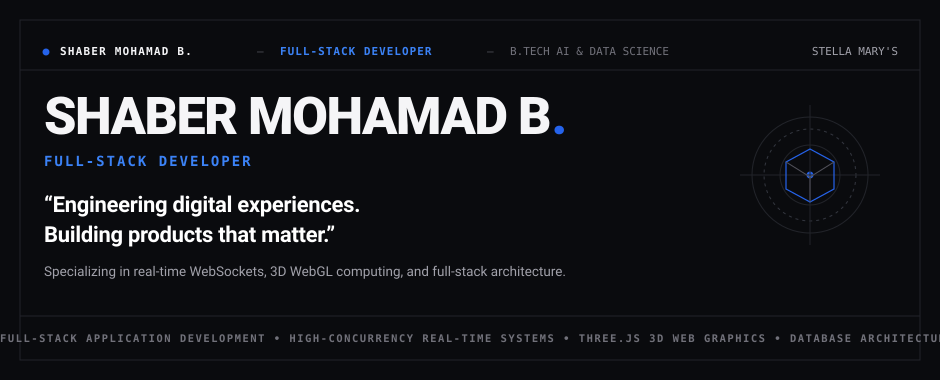
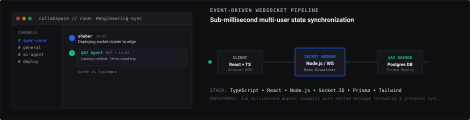
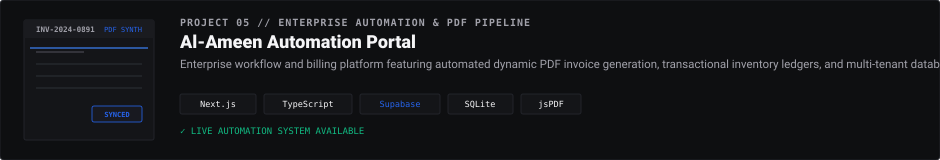
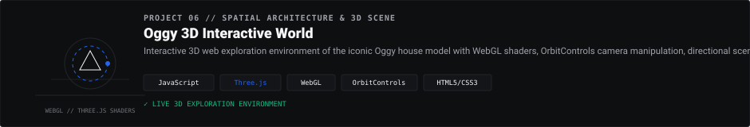
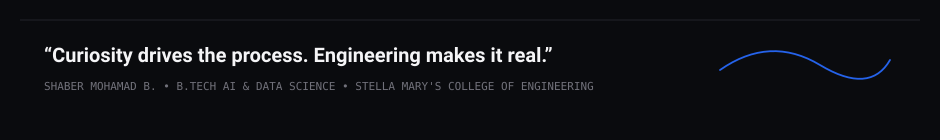

<!-- ========================================================================= -->
<!-- 01. HERO — SIGNATURE IDENTITY                                             -->
<!-- ========================================================================= -->

 

<!-- EDITORIAL NAVIGATION / ACTION FOLIO -->

  <a href="https://shaber-portfolio-26bm-beta.vercel.app/"><b>Live Portfolio</b></a> &nbsp;&bull;&nbsp;
  <a href="https://github.com/shabermohamadb?tab=repositories"><b>Public Repositories</b></a> &nbsp;&bull;&nbsp;
  <a href="https://www.linkedin.com/in/b-shaber-mohamad-73a612318"><b>LinkedIn Profile</b></a> &nbsp;&bull;&nbsp;
  <a href="mailto:shabermohamad.dev@gmail.com"><b>Direct Dispatch</b></a>

 

<!-- ========================================================================= -->
<!-- 02. PROFESSIONAL INTRODUCTION                                             -->
<!-- ========================================================================= -->

## Professional Introduction

<table>
  <tr>
    <td width="55%" valign="top">
      <h3>Background &amp; Philosophy</h3>
      

        I am <b>Shaber Mohamad B.</b>, a Full-Stack Developer and Artificial Intelligence &amp; Data Science engineer based in Tamil Nadu, India, pursuing my B.Tech at <b>Stella Mary's College of Engineering</b>.
      

      

        I design, architect, and ship software with a focus on real-world utility: high-concurrency real-time communication platforms, production food commerce engines, spatial 3D WebGL experiences, and desktop engineering software.
      

      

        My development philosophy prioritizes sound software fundamentals &mdash; predictable state management, resilient backend architecture, disciplined type safety, and clean editorial typography.
      

    </td>
    <td width="45%" valign="top">
      <h3>Core Engineering Focus</h3>
      <ul>
        <li><b>Full-Stack Application Development</b>: Building end-to-end web products from database schema design through serverless edge deployment.</li>
        <li><b>Real-Time Distributed Systems</b>: Engineering bi-directional WebSocket conduits, multi-user room state synchronization, and live presence daemons using Socket.IO.</li>
        <li><b>Interactive 3D &amp; Spatial Graphics</b>: Translating spatial geometry into interactive web environments using Three.js and WebGL shaders.</li>
        <li><b>Systems &amp; Automation Tooling</b>: Authoring desktop EDA schematic routing tools in Python/PySide6 and business PDF automation pipelines.</li>
      </ul>
    </td>
  </tr>
</table>

 

  

 

<!-- ========================================================================= -->
<!-- 03. ENGINEERING TOOLKIT                                                   -->
<!-- ========================================================================= -->

## Engineering Toolkit

A comprehensive, categorized technical index of verified skills and tools applied across production systems and open-source software.

<table>
  <thead>
    <tr align="left">
      <th width="22%">Category</th>
      <th width="33%">Verified Technologies</th>
      <th width="45%">Implementation &amp; Architectural Context</th>
    </tr>
  </thead>
  <tbody>
    <tr>
      <td><b>Frontend Engineering</b></td>
      <td>
        
      </td>
      <td>
        Component-driven architectures in React &amp; Next.js (App Router), strict TypeScript type modeling, Tailwind CSS design systems, WebGL camera frustum manipulation, and accessible HTML5/CSS3.
      </td>
    </tr>
    <tr>
      <td><b>Backend Engineering</b></td>
      <td>
        
      </td>
      <td>
        Event-driven RESTful APIs and micro-services in Node.js &amp; Express, bi-directional Socket.IO duplex conduits, JWT session authentication, and Python asynchronous background workers.
      </td>
    </tr>
    <tr>
      <td><b>Databases &amp; Infrastructure</b></td>
      <td>
        
      </td>
      <td>
        Relational schema design and indexing in PostgreSQL &amp; SQLite, real-time row-level subscriptions &amp; object storage via Supabase, flexible document schemas in MongoDB, and Vercel edge infrastructure.
      </td>
    </tr>
    <tr>
      <td><b>Programming Languages</b></td>
      <td>
        
      </td>
      <td>
        TypeScript &amp; JavaScript for type-safe full-stack platforms, Python for data science, algorithmic graph routing &amp; PySide6 GUI suites, and C++ for systems and algorithmic foundations.
      </td>
    </tr>
    <tr>
      <td><b>Development Tools</b></td>
      <td>
        
      </td>
      <td>
        Git version control, Linux command-line development environments, Docker containerization, automated CI/CD GitHub Actions workflows, Vite bundling, and Postman API contract testing.
      </td>
    </tr>
  </tbody>
</table>

 

  

 

<!-- ========================================================================= -->
<!-- 04. SELECTED ENGINEERING PROJECTS                                         -->
<!-- ========================================================================= -->

## Selected Engineering Projects

A curated portfolio of verified production systems, real-time web applications, and system software built from the ground up.

 

### 01 &mdash; CollabSpace
*Real-Time Multi-User Collaborative Workspace &amp; AI Teammate Daemon*

  

  <b>Project Overview:</b> A production-grade multi-user collaboration platform engineered for team communication and contextual assistant participation. Built with an event-driven Socket.IO cluster delivering sub-millisecond message delivery across active channels.

  <b>Technical Highlights:</b>

<ul>
  <li><b>Real-Time Event Bus</b>: Implemented bi-directional WebSocket conduits handling broadcast events (<code>message:send</code>, <code>typing:stream</code>, <code>presence:sync</code>).</li>
  <li><b>Nested Message Threading</b>: Engineered threaded discussions with recursive reply counters preserving main room context.</li>
  <li><b>Contextual <code>@AI</code> Teammate</b>: Integrated an automated AI participant daemon that inspects recent room chat history to synthesize structured technical responses directly inside conversation threads.</li>
  <li><b>Relational Persistence</b>: Modeled structured user schemas, room access permissions, and message history using PostgreSQL and Prisma ORM.</li>
</ul>

  <b>Stack:</b> <code>TypeScript</code> &bull; <code>React</code> &bull; <code>Node.js</code> &bull; <code>Express</code> &bull; <code>Socket.IO</code> &bull; <code>Prisma (PostgreSQL)</code> &bull; <code>Tailwind CSS</code> 
  <b>Source Code:</b> <a href="https://github.com/shabermohamadb/collab-chat"><b>github.com/shabermohamadb/collab-chat ↗</b></a>

 

### 02 &mdash; Floz Food Commerce Engine
*Commercial Food Ordering Platform &amp; Administrative Dispatch Portal*

  

  <b>Project Overview:</b> An end-to-end digital food commerce engine built for a physical commercial client, <i>A-One Shawarma Spot (Nagercoil)</i>. Replaces manual order logging with an automated digital catalog, authenticated ordering, and a live kitchen dispatching console.

  <b>Technical Highlights:</b>

<ul>
  <li><b>Instant Dynamic Menu Filtering</b>: Sub-10ms category querying with image caching and dietary filters.</li>
  <li><b>Persistent Client State</b>: Resilient cart store with local cache hydration, dynamic price re-calculation, and delivery fee rules.</li>
  <li><b>Secure JWT Checkout</b>: Stateless token authentication for customer order history and administrative order confirmation.</li>
  <li><b>Order Lifecycle Tracking</b>: Real-time visual progress monitoring from kitchen preparation through delivery dispatch.</li>
</ul>

  <b>Stack:</b> <code>React</code> &bull; <code>Vite</code> &bull; <code>Node.js</code> &bull; <code>Express</code> &bull; <code>JWT Authentication</code> &bull; <code>Tailwind CSS</code> 
  <b>Transmissions:</b> <a href="https://floz-food-ordering.vercel.app/"><b>Live Commercial Deployment ↗</b></a> &nbsp;&bull;&nbsp; <a href="https://github.com/shabermohamadb/floz-food-ordering"><b>github.com/shabermohamadb/floz-food-ordering ↗</b></a>

 

### 03 &mdash; Hidden Number 3D
*Multiplayer Social Deduction Game in Three.js (WebGL)*

  

  <b>Project Overview:</b> A real-time multiplayer 3D party game where participants use deductive reasoning to determine concealed room numbers while navigating interactive 3D spatial geometry in the browser.

  <b>Technical Highlights:</b>

<ul>
  <li><b>Spatial WebGL Rendering</b>: Built dynamic polyhedral geometric meshes, custom lighting shaders, and perspective camera orbits using Three.js.</li>
  <li><b>Cryptographic Number Veils</b>: Conceived server-authoritative room state synchronization via Socket.IO, preventing client-side DOM or network inspection of opponent numbers.</li>
  <li><b>Responsive Spatial Viewport</b>: Automatic canvas aspect-ratio recalculation maintaining crisp 60fps rendering across mobile and desktop displays.</li>
</ul>

  <b>Stack:</b> <code>TypeScript</code> &bull; <code>React</code> &bull; <code>Three.js (WebGL)</code> &bull; <code>Socket.IO</code> &bull; <code>Tailwind CSS</code> 
  <b>Transmissions:</b> <a href="https://hidden-number.vercel.app/"><b>Live WebGL Application ↗</b></a> &nbsp;&bull;&nbsp; <a href="https://github.com/shabermohamadb/hidden-number"><b>github.com/shabermohamadb/hidden-number ↗</b></a>

 

### 04 &mdash; CircuitX &mdash; AI PCB Designer
*Desktop Electronic Design Automation (EDA) &amp; Schematic Routing Suite*

  

  <b>Project Overview:</b> A specialized desktop software suite engineered to assist electronics developers with circuit schematic capture, component netlist validation, and automated printed circuit board (PCB) trace routing.

  <b>Technical Highlights:</b>

<ul>
  <li><b>Desktop Native Performance</b>: Engineered an interactive vector drafting canvas using Python and PySide6 (Qt6 GUI framework).</li>
  <li><b>Heuristic Graph Routing</b>: Implemented spatial routing algorithms powered by NumPy matrix arrays to minimize trace lengths and prevent net collisions.</li>
  <li><b>Validation Test Harness</b>: Rigorous automated testing via Pytest verifying netlist continuity and pin assignments before trace rendering.</li>
</ul>

  <b>Stack:</b> <code>Python</code> &bull; <code>PySide6 (Qt6)</code> &bull; <code>NumPy</code> &bull; <code>Pytest</code> &bull; <code>Graph Heuristics</code> 
  <b>Source Code:</b> <a href="https://github.com/shabermohamadb/AI-Based-PCP-Design-Software"><b>github.com/shabermohamadb/AI-Based-PCP-Design-Software ↗</b></a>

 

### 05 &mdash; Al-Ameen Automation Portal
*Enterprise Workflow Management &amp; Dynamic PDF Document Synthesis*

  

  <b>Project Overview:</b> A cloud-synchronized enterprise administration portal engineered for small-to-medium business operations, automated client billing, inventory ledger tracking, and instant client invoice generation.

  <b>Technical Highlights:</b>

<ul>
  <li><b>Automated Client PDF Synthesis</b>: Client-side vector generation of formal invoices using <code>jsPDF</code> and <code>jspdf-autotable</code> with automated line-item tax calculation.</li>
  <li><b>Hybrid State Persistence</b>: Multi-tenant relational cloud data storage via Supabase with offline SQLite local caching.</li>
  <li><b>Role-Based Access Guard</b>: Granular administrative permissions protecting transactional ledger history.</li>
</ul>

  <b>Stack:</b> <code>Next.js</code> &bull; <code>TypeScript</code> &bull; <code>Supabase</code> &bull; <code>SQLite</code> &bull; <code>jsPDF</code> &bull; <code>Tailwind CSS</code> 
  <b>Transmissions:</b> <a href="https://al-ameen-automation.vercel.app/"><b>Live Automation Portal ↗</b></a> &nbsp;&bull;&nbsp; <a href="https://github.com/shabermohamadb/al-ameen-automation"><b>github.com/shabermohamadb/al-ameen-automation ↗</b></a>

 

### 06 &mdash; Oggy 3D Interactive World
*Architectural 3D Scene Exploration &amp; Shader Lighting*

  

  <b>Project Overview:</b> A web-first 3D digital scene exploration of the iconic Oggy house model, demonstrating camera orbit manipulation, volumetric mesh lighting, and interactive WebGL shaders.

  <b>Stack:</b> <code>JavaScript</code> &bull; <code>Three.js</code> &bull; <code>WebGL</code> &bull; <code>OrbitControls</code> &bull; <code>HTML5/CSS3</code> 
  <b>Transmissions:</b> <a href="https://oggy-house-3d-model.vercel.app/"><b>Live 3D Scene ↗</b></a> &nbsp;&bull;&nbsp; <a href="https://github.com/shabermohamadb/oggy-house-3d-model"><b>github.com/shabermohamadb/oggy-house-3d-model ↗</b></a>

 

  

 

<!-- ========================================================================= -->
<!-- 05. GITHUB ENGINEERING ACTIVITY                                           -->
<!-- ========================================================================= -->

## GitHub Engineering Activity

Accurate public metrics reflecting daily open-source contributions, commit frequency, and repository development.

<!-- GitHub Contribution Grid Snake (Automated via GitHub Actions) -->
<picture>
  <source media="(prefers-color-scheme: dark)" srcset="https://raw.githubusercontent.com/shabermohamadb/shabermohamadb/output/github-contribution-grid-snake-dark.svg" />
  
</picture>

  

<!-- Verified Contribution Streak Telemetry -->

  

<!-- Contribution Velocity Graph -->

 

  

 

<!-- ========================================================================= -->
<!-- 06. MOTION DESIGN SYSTEM                                                  -->
<!-- ========================================================================= -->

## Motion Design System

Every animation in this portfolio is engineered using sanitization-safe SVG techniques and native CSS `@keyframes` that execute smoothly within GitHub's environment:

* **01. SVG Path Line Drawing**: Animated `stroke-dasharray` and `stroke-dashoffset` creating precision vector outlines in [`portfolio-hero.svg`](assets/portfolio-hero.svg) and [`portfolio-footer.svg`](assets/portfolio-footer.svg).
* **02. Continuous Marquee Ticker**: Smooth horizontal linear animation (`@keyframes tickerMarquee 24s linear infinite`) displaying core engineering competencies across the hero baseline.
* **03. Mechanical Compass Rotation**: Hairline concentric measurement ring rotating with mathematical regularity (`@keyframes slowCompass 28s linear infinite`).
* **04. Bi-Directional Packet Flow**: Multi-user data packets traversing Socket.IO conduits in real time in [`work-collabspace.svg`](assets/work-collabspace.svg).
* **05. Live Typing Telemetry**: Staggered opacity keyframes simulating active user typing pulses.
* **06. Order Dispatch Step Pulse**: Discrete status step transitions in [`work-floz.svg`](assets/work-floz.svg) demonstrating production state progression.
* **07. 3D Spatial Polyhedral Rotation**: Smooth isometric wireframe polyhedron rotation simulating Three.js spatial depth in [`work-hidden-number.svg`](assets/work-hidden-number.svg).
* **08. Dynamic Laser Scanning**: Vertical document synthesis scan line in [`project-alameen.svg`](assets/project-alameen.svg).
* **09. Schematic Circuit Trace Travel**: Pulsing electrical current traversing PCB netlist traces in [`work-circuitx.svg`](assets/work-circuitx.svg).
* **10. 3D Orbit Controls Frustum**: Concentric camera viewport rotation in [`project-oggy.svg`](assets/project-oggy.svg).
* **11. Contribution Snake Progression**: Automated daily contribution grid traversal generated via GitHub Actions.
* **12. Structural Hairline Separation**: Minimal 1px architectural divider rules providing clear editorial pacing.

 

  

 

<!-- ========================================================================= -->
<!-- 07. PROFESSIONAL CONTACT & FOOTER                                         -->
<!-- ========================================================================= -->

  

    

  

    <a href="https://shaber-portfolio-26bm-beta.vercel.app/"><b>Live Portfolio</b></a> &nbsp;&bull;&nbsp;
    <a href="https://www.linkedin.com/in/b-shaber-mohamad-73a612318"><b>LinkedIn Profile</b></a> &nbsp;&bull;&nbsp;
    <a href="https://github.com/shabermohamadb"><b>GitHub Repositories</b></a> &nbsp;&bull;&nbsp;
    <a href="mailto:shabermohamad.dev@gmail.com"><b>Direct Dispatch</b></a>
  

  SHABER MOHAMAD B. &bull; B.TECH ARTIFICIAL INTELLIGENCE &amp; DATA SCIENCE &bull; STELLA MARY'S COLLEGE OF ENGINEERING &bull; TAMIL NADU, INDIA

