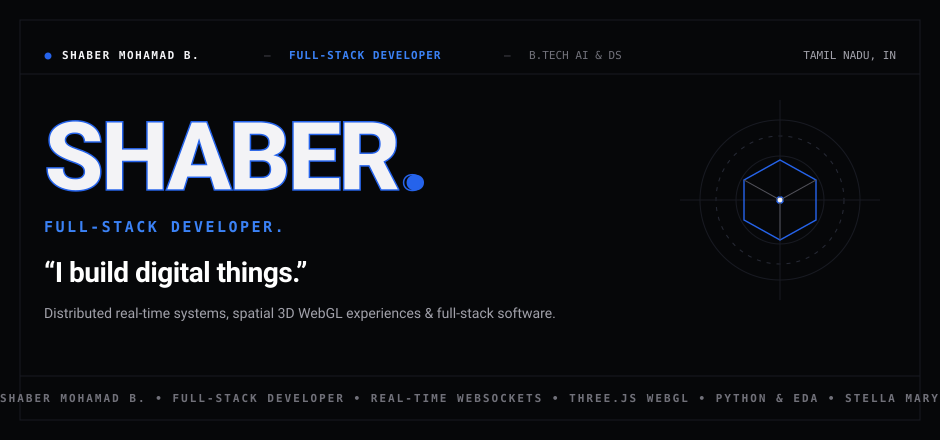
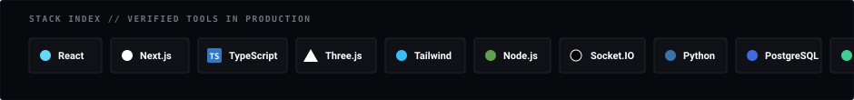
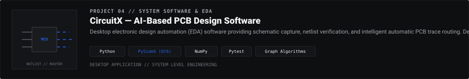
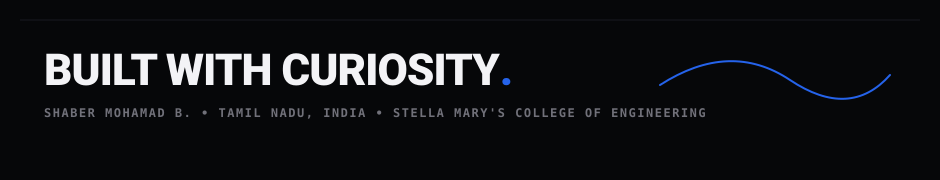

<!-- ========================================================================= -->
<!-- 1. HERO — SHABER.                                                         -->
<!-- ========================================================================= -->

 

<!-- MINIMAL TRANSMISSION FOLIO -->

  <a href="https://shaber-portfolio-26bm-beta.vercel.app/"><b>Portfolio</b></a> &nbsp;&bull;&nbsp;
  <a href="https://github.com/shabermohamadb?tab=repositories"><b>Work</b></a> &nbsp;&bull;&nbsp;
  <a href="https://www.linkedin.com/in/b-shaber-mohamad-73a612318"><b>LinkedIn</b></a> &nbsp;&bull;&nbsp;
  <a href="mailto:shabermohamad.dev@gmail.com"><b>Email</b></a>

 

<!-- ========================================================================= -->
<!-- 2. TECH STACK: ANIMATED HORIZONTAL STREAM                                 -->
<!-- ========================================================================= -->

  

 

<!-- ========================================================================= -->
<!-- 3. SELECTED WORK: CREATIVE VISUAL GALLERY (BEST 4 PROJECTS)               -->
<!-- ========================================================================= -->

## Selected Work

 

### 01 &mdash; CollabSpace
*Real-time multi-user collaborative workspace with Socket.IO concurrency, threaded discussions, and contextual AI daemons.*

  

  <a href="https://github.com/shabermohamadb/collab-chat"><b>Source Code &amp; Architecture Documentation ↗</b></a>

 

### 02 &mdash; Floz Food Commerce
*Production food commerce engine and administrative dispatch dashboard engineered for A-One Shawarma Spot.*

  

  <a href="https://floz-food-ordering.vercel.app/"><b>Live Commercial Demo ↗</b></a> &nbsp;&bull;&nbsp;
  <a href="https://github.com/shabermohamadb/floz-food-ordering"><b>Source Code ↗</b></a>

 

### 03 &mdash; Hidden Number 3D
*Multiplayer 3D social deduction game built with Three.js spatial camera depth and server-verified room state.*

  

  <a href="https://hidden-number.vercel.app/"><b>Live WebGL Application ↗</b></a> &nbsp;&bull;&nbsp;
  <a href="https://github.com/shabermohamadb/hidden-number"><b>Source Code ↗</b></a>

 

### 04 &mdash; CircuitX &mdash; AI PCB Designer
*Desktop electronic design automation software for schematic capture and heuristic PCB trace routing in Python and PySide6.*

  

  <a href="https://github.com/shabermohamadb/AI-Based-PCP-Design-Software"><b>Source Code &amp; EDA Engine ↗</b></a>

 

  

 

<!-- ========================================================================= -->
<!-- 4. GITHUB ACTIVITY                                                        -->
<!-- ========================================================================= -->

## Activity

<!-- Contribution Snake Animation -->
<picture>
  <source media="(prefers-color-scheme: dark)" srcset="https://raw.githubusercontent.com/shabermohamadb/shabermohamadb/output/github-contribution-grid-snake-dark.svg" />
  
</picture>

  

<!-- Contribution Streak Card -->

  

<!-- Contribution Activity Graph -->

  

 

<!-- ========================================================================= -->
<!-- 5. SIGNATURE FOOTER                                                       -->
<!-- ========================================================================= -->

  

    

  

    <a href="https://shaber-portfolio-26bm-beta.vercel.app/"><b>Portfolio</b></a> &nbsp;&bull;&nbsp;
    <a href="https://www.linkedin.com/in/b-shaber-mohamad-73a612318"><b>LinkedIn</b></a> &nbsp;&bull;&nbsp;
    <a href="https://github.com/shabermohamadb"><b>GitHub</b></a> &nbsp;&bull;&nbsp;
    <a href="mailto:shabermohamad.dev@gmail.com"><b>Email</b></a>
  

  SHABER MOHAMAD B. &bull; TAMIL NADU, INDIA

