<!-- CINEMATIC ANIME HERO BANNER -->

 

<!-- QUICK ACCESS COORDINATES -->

  <a href="https://shaber-portfolio-26bm-beta.vercel.app/"><b>Portfolio</b></a> &nbsp;&bull;&nbsp;
  <a href="https://github.com/shabermohamadb?tab=repositories"><b>GitHub Archives</b></a> &nbsp;&bull;&nbsp;
  <a href="https://www.linkedin.com/in/b-shaber-mohamad-73a612318"><b>LinkedIn</b></a> &nbsp;&bull;&nbsp;
  <a href="mailto:shabermohamad.dev@gmail.com"><b>Direct Comms</b></a>

### // 01 &bull; CHARACTER DOSSIER &bull; 人物設定

I am a **Full-Stack Developer** and **AI & Data Science student** based in Tamil Nadu, India. Like a builder in a cyberpunk world writing code late into the night while rain slides down the workshop window, I treat software engineering as both discipline and creative art.

My core focus centers around:
* **Full-Stack Web Architectures:** Engineering end-to-end applications from typed clients to resilient distributed backends.
* **Artificial Intelligence & Machine Learning:** Developing predictive models, conversational agents, and natural language understanding pipelines.
* **Real-Time Systems & WebSockets:** Building low-latency multiplayer rooms, concurrent message sync, and distributed state engines.
* **Creative UI/UX & Spatial WebGL:** Designing high-framerate interactive interfaces, fluid animations, and 3D browser viewports.

  

### // 02 &bull; ABILITY MATRIX &bull; 技術能力

  

* **Sensory & Interface Engines (Frontend):**  
  `React` &bull; `Next.js` &bull; `TypeScript` &bull; `JavaScript` &bull; `HTML5 / CSS3` &bull; `Tailwind CSS` &bull; `Framer Motion` &bull; `Three.js (WebGL)`
* **Core Runtimes & Server Systems (Backend):**  
  `Node.js` &bull; `Express.js` &bull; `Python` &bull; `REST APIs` &bull; `Socket.IO` &bull; `JWT Auth` &bull; `AsyncIO`
* **Persistent Grids & Memory (Databases):**  
  `PostgreSQL` &bull; `Supabase` &bull; `MongoDB` &bull; `Relational Schemas`
* **Neural Networks & Predictive Analytics (AI & Data Science):**  
  `Python` &bull; `NumPy` &bull; `Pandas` &bull; `Scikit-Learn` &bull; `Machine Learning` &bull; `Jupyter Notebooks`
* **Field Gear & Operations (Tools & DevOps):**  
  `Git` &bull; `GitHub` &bull; `Linux (Arch / Debian)` &bull; `Docker` &bull; `Vite` &bull; `VS Code`

  

### // 03 &bull; ACTIVE MISSIONS &bull; 進行中の任務

Verified mission files extracted directly from public repository deployments:

#### &bull; MISSION 01 &mdash; [CollabSpace](https://collab-chat-five.vercel.app/) // Real-Time AI Workspace
A multi-user team collaboration platform featuring instant room messaging powered by sub-millisecond Socket.IO sync and a first-class contextual `@AI` teammate participating directly in conversation threads.
* **Mission Stack:** `TypeScript` &bull; `Node.js` &bull; `Express.js` &bull; `Socket.IO` &bull; `Tailwind CSS`
* **Coordinates:** [Live Deployment ↗](https://collab-chat-five.vercel.app/) &bull; [Mission Source (GitHub) ↗](https://github.com/shabermohamadb/collab-chat)

#### &bull; MISSION 02 &mdash; [Floz Food Ordering](https://floz-food-ordering.vercel.app/) // Commercial Dispatch Engine
Production food ordering suite and administrative command dashboard built for *A-One Shawarma Spot (EASY BUY Groceries & Foods)*. Handles dynamic menu state, cart synchronization, JWT authentication, and live kitchen dispatch.
* **Mission Stack:** `React` &bull; `Vite` &bull; `Node.js` &bull; `Express.js` &bull; `JWT` &bull; `Framer Motion`
* **Coordinates:** [Live Deployment ↗](https://floz-food-ordering.vercel.app/) &bull; [Mission Source (GitHub) ↗](https://github.com/shabermohamadb/floz-food-ordering)

#### &bull; MISSION 03 &mdash; [Hidden Number](https://hidden-number.vercel.app/) // Spatial Social Deduction Arena
Multiplayer social deduction arena built around spatial depth and mathematical information veil: each player's unique secret number is visible to everyone in the arena except themselves.
* **Mission Stack:** `TypeScript` &bull; `React` &bull; `Three.js (WebGL)` &bull; `Socket.IO` &bull; `Tailwind CSS`
* **Coordinates:** [Live Deployment ↗](https://hidden-number.vercel.app/) &bull; [Mission Source (GitHub) ↗](https://github.com/shabermohamadb/hidden-number)

#### &bull; MISSION 04 &mdash; [Machine Learning Intelligence Suite](https://github.com/shabermohamadb/PRODIGY_DS_04) // Predictive Pipelines
Applied machine learning pipelines covering Twitter brand sentiment classification via NLP (`PRODIGY_DS_04`), supervised customer term-deposit Decision Trees on the UCI Bank dataset (`PRODIGY_DS_03`), and US traffic accident spatial analytics (`PRODIGY_DS_05`).
* **Mission Stack:** `Python` &bull; `NumPy` &bull; `Pandas` &bull; `Scikit-Learn` &bull; `Matplotlib` &bull; `Seaborn`
* **Coordinates:** [Mission Source (GitHub) ↗](https://github.com/shabermohamadb/PRODIGY_DS_04)

  

### // 04 &bull; DEVELOPER JOURNEY &amp; BATTLE PROGRESSION &bull; 戦歴

<!-- CONTRIBUTION SNAKE AUTOMATION (Powered by GitHub Actions) -->
<picture>
  <source media="(prefers-color-scheme: dark)" srcset="https://raw.githubusercontent.com/shabermohamadb/shabermohamadb/output/github-contribution-grid-snake-dark.svg">
  
</picture>

 

<!-- ANIME TWILIGHT STREAK TELEMETRY -->

  

### // 05 &bull; SUBSPACE TRANSMISSION &bull; 通信

Whether you have a full-stack engineering role, an AI collaboration, or a technical inquiry:

* **Neural Portal (Portfolio):** [shaber-portfolio-26bm-beta.vercel.app ↗](https://shaber-portfolio-26bm-beta.vercel.app/)
* **Professional Frequency (LinkedIn):** [linkedin.com/in/b-shaber-mohamad-73a612318 ↗](https://www.linkedin.com/in/b-shaber-mohamad-73a612318)
* **Direct Electronic Mail:** [shabermohamad.dev@gmail.com](mailto:shabermohamad.dev@gmail.com)
* **Code Vault (GitHub):** [github.com/shabermohamadb ↗](https://github.com/shabermohamadb)

 

  SHABER MOHAMAD B &bull; 13.0827° N, 80.2707° E &bull; TAMIL NADU, INDIA

