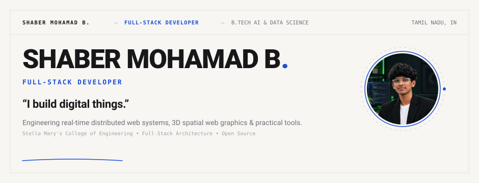
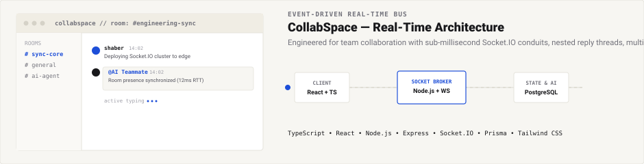
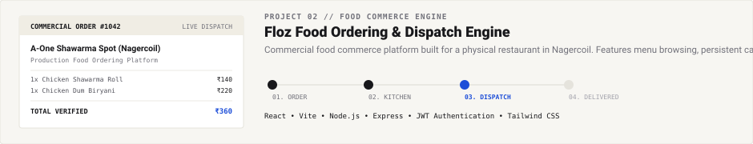
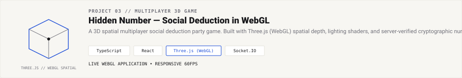
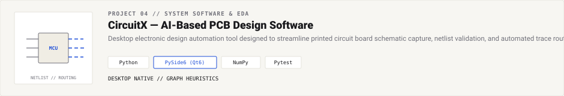
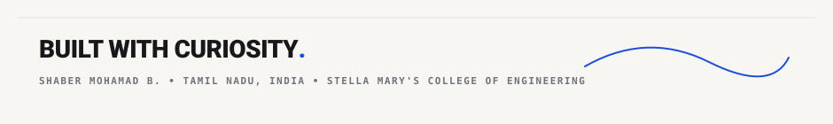

<!-- ========================================================================= -->
<!-- 1. HERO — SHABER MOHAMAD B.                                               -->
<!-- ========================================================================= -->

 

<!-- EDITORIAL NAVIGATION FOLIO -->

  <a href="https://shaber-portfolio-26bm-beta.vercel.app/"><b>Portfolio</b></a> &nbsp;&#8226;&nbsp;
  <a href="https://github.com/shabermohamadb?tab=repositories"><b>Work</b></a> &nbsp;&#8226;&nbsp;
  <a href="https://www.linkedin.com/in/b-shaber-mohamad-73a612318"><b>LinkedIn</b></a> &nbsp;&#8226;&nbsp;
  <a href="mailto:shabermohamad.dev@gmail.com"><b>Email</b></a>

 

<!-- ========================================================================= -->
<!-- 2. ABOUT (MAX 2 SHORT SENTENCES)                                          -->
<!-- ========================================================================= -->

Full-stack engineer focusing on real-time distributed web systems, 3D spatial interfaces, and practical software tools. Currently pursuing B.Tech in Artificial Intelligence & Data Science at Stella Mary's College of Engineering.

 

<!-- ========================================================================= -->
<!-- 3. TECHNOLOGIES                                                           -->
<!-- ========================================================================= -->

  
    
  

 

<!-- ========================================================================= -->
<!-- 4. SELECTED WORK (4 VERIFIED PROJECTS GALLERY)                             -->
<!-- ========================================================================= -->

## Selected Work

 

### 01 &#8212; CollabSpace
*Real-time multi-user collaborative workspace with Socket.IO concurrency, threaded discussions, and contextual AI thread participation.*

  

  <a href="https://github.com/shabermohamadb/collab-chat"><b>Source Code &amp; Architecture Documentation ↗</b></a>

 

### 02 &#8212; Floz Food Commerce
*Production food commerce engine and administrative dispatch dashboard engineered for A-One Shawarma Spot.*

  

  <a href="https://floz-food-ordering.vercel.app/"><b>Live Commercial Demo ↗</b></a> &nbsp;&#8226;&nbsp;
  <a href="https://github.com/shabermohamadb/floz-food-ordering"><b>Source Code ↗</b></a>

 

### 03 &#8212; Hidden Number 3D
*Multiplayer 3D social deduction party game built with Three.js WebGL spatial rendering and cryptographic state verification.*

  

  <a href="https://hidden-number.vercel.app/"><b>Live WebGL Application ↗</b></a> &nbsp;&#8226;&nbsp;
  <a href="https://github.com/shabermohamadb/hidden-number"><b>Source Code ↗</b></a>

 

### 04 &#8212; CircuitX &#8212; AI PCB Designer
*Desktop electronic design automation software for schematic capture, netlist validation, and automated trace routing in Python and PySide6.*

  

  <a href="https://github.com/shabermohamadb/AI-Based-PCP-Design-Software"><b>Source Code &amp; EDA Engine ↗</b></a>

 

  

 

<!-- ========================================================================= -->
<!-- 5. GITHUB ACTIVITY                                                        -->
<!-- ========================================================================= -->

## Activity

<!-- Contribution Snake Animation -->
<picture>
  <source media="(prefers-color-scheme: dark)" srcset="https://raw.githubusercontent.com/shabermohamadb/shabermohamadb/output/github-contribution-grid-snake-dark.svg" />
  
</picture>

  

<!-- Contribution Streak Card -->

  

<!-- Contribution Activity Graph -->

  

 

<!-- ========================================================================= -->
<!-- 6. SIGNATURE FOOTER                                                       -->
<!-- ========================================================================= -->

  

    

  

    <a href="https://shaber-portfolio-26bm-beta.vercel.app/"><b>Portfolio</b></a> &nbsp;&#8226;&nbsp;
    <a href="https://www.linkedin.com/in/b-shaber-mohamad-73a612318"><b>LinkedIn</b></a> &nbsp;&#8226;&nbsp;
    <a href="https://github.com/shabermohamadb"><b>GitHub</b></a> &nbsp;&#8226;&nbsp;
    <a href="mailto:shabermohamad.dev@gmail.com"><b>Email</b></a>
  

  SHABER MOHAMAD B. &#8226; TAMIL NADU, INDIA

