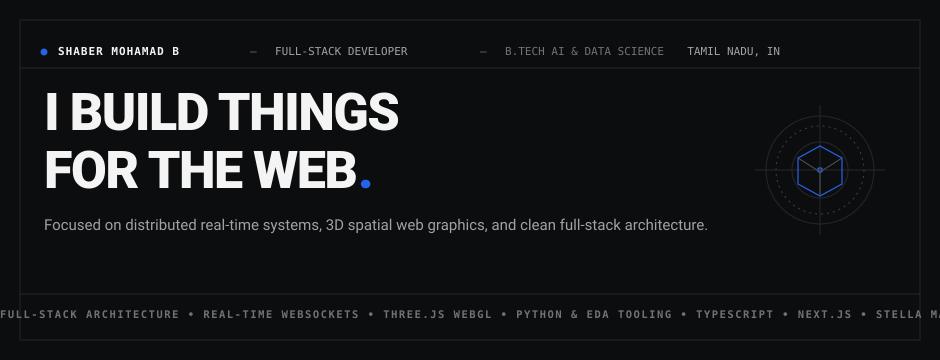
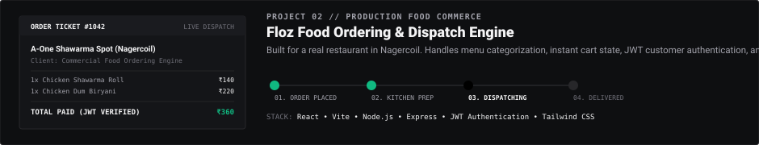
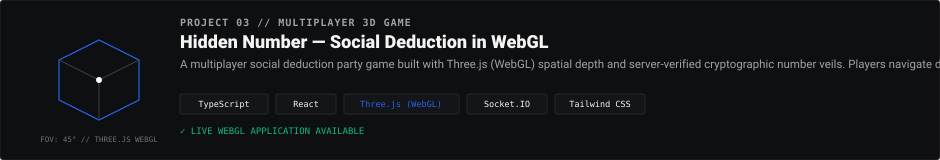
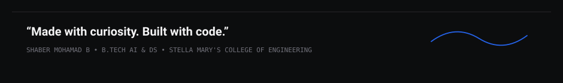

<!-- ========================================================================= -->
<!-- 1. HERO: SWISS EDITORIAL KINETIC TYPOGRAPHY POSTER                        -->
<!-- ========================================================================= -->

 

<!-- MINIMAL NAVIGATION / ACTION BAR -->

  <a href="https://shaber-portfolio-26bm-beta.vercel.app/"><b>Portfolio</b></a> &nbsp;&bull;&nbsp;
  <a href="https://github.com/shabermohamadb?tab=repositories"><b>Selected Work</b></a> &nbsp;&bull;&nbsp;
  <a href="https://www.linkedin.com/in/b-shaber-mohamad-73a612318"><b>LinkedIn</b></a> &nbsp;&bull;&nbsp;
  <a href="mailto:shabermohamad.dev@gmail.com"><b>Contact</b></a>

 

<!-- ========================================================================= -->
<!-- 2. ABOUT                                                                  -->
<!-- ========================================================================= -->

## About

<table>
  <tr>
    <td width="55%" valign="top">
      <h3>Who I Am</h3>
      

        I'm <b>Shaber Mohamad</b>, a full-stack developer and AI &amp; Data Science student at <b>Stella Mary's College of Engineering</b> in Tamil Nadu, India.
      

      

        I enjoy building things that live on the web &mdash; from responsive frontends and real-time multiplayer systems to desktop engineering tools. I care deeply about clean typography, intuitive user interactions, and sound backend fundamentals.
      

    </td>
    <td width="45%" valign="top">
      <h3>What I Focus On</h3>
      <ul>
        <li><b>Real-Time Web Applications</b>: Low-latency Socket.IO conduits, multi-user presence, and collaborative room state.</li>
        <li><b>3D &amp; Spatial Graphics</b>: Interactive WebGL experiences, Three.js shaders, and spatial web deductions.</li>
        <li><b>Full-Stack Engineering</b>: Production-ready commerce engines, relational database design, and automated business workflows.</li>
      </ul>
    </td>
  </tr>
</table>

 

  

 

<!-- ========================================================================= -->
<!-- 3. TECHNOLOGY INDEX                                                       -->
<!-- ========================================================================= -->

## Technology Index

A breakdown of the tools and technologies I use to design and build software, organized by functional domain.

<table>
  <thead>
    <tr align="left">
      <th width="20%">Domain</th>
      <th width="35%">Core Technologies</th>
      <th width="45%">Usage &amp; Implementation Context</th>
    </tr>
  </thead>
  <tbody>
    <tr>
      <td><b>Frontend &amp; 3D</b></td>
      <td>
        
      </td>
      <td>
        Component architecture, Next.js App Router, TypeScript type safety, Tailwind design systems, and Three.js 3D WebGL scenes.
      </td>
    </tr>
    <tr>
      <td><b>Backend &amp; Real-Time</b></td>
      <td>
        
      </td>
      <td>
        Event-driven servers in Node.js &amp; Express, bidirectional Socket.IO WebSockets, RESTful endpoints, and Python data services.
      </td>
    </tr>
    <tr>
      <td><b>Databases &amp; State</b></td>
      <td>
        
      </td>
      <td>
        Relational schema design with PostgreSQL and SQLite, realtime subscriptions &amp; authentication via Supabase, and flexible storage with MongoDB.
      </td>
    </tr>
    <tr>
      <td><b>Systems &amp; Tooling</b></td>
      <td>
        
      </td>
      <td>
        Git version control, Linux command-line development, Docker containerization, PySide6 (Qt) desktop applications, and automated GitHub Actions.
      </td>
    </tr>
  </tbody>
</table>

 

  

 

<!-- ========================================================================= -->
<!-- 4. SELECTED WORK                                                          -->
<!-- ========================================================================= -->

## Selected Work

A curated collection of real projects I've designed, architected, and built.

 

### 01 &mdash; CollabSpace
*Real-Time Multi-User Collaborative Workspace &amp; AI Teammate*

  

  A production-grade collaborative chat platform engineered for multi-user team synchronization. Features channel workspaces, nested message reply threads, live typing indicators, and a contextual <code>@AI</code> assistant daemon that reads thread context and responds in real time.

  <b>Stack:</b> <code>TypeScript</code> &bull; <code>React</code> &bull; <code>Node.js</code> &bull; <code>Express</code> &bull; <code>Socket.IO</code> &bull; <code>Prisma (PostgreSQL)</code> &bull; <code>Tailwind CSS</code> 
  <b>Links:</b> <a href="https://github.com/shabermohamadb/collab-chat"><b>Source Code &amp; Architecture Documentation ↗</b></a>

 

### 02 &mdash; Floz Food Commerce
*Commercial Food Ordering &amp; Live Dispatch Portal*

  

  Built for <i>A-One Shawarma Spot (Nagercoil)</i>. Features instant menu browsing, persistent cart management, token-authenticated checkout, and an administrative order management dashboard with real-time preparation and dispatch tracking.

  <b>Stack:</b> <code>React</code> &bull; <code>Vite</code> &bull; <code>Node.js</code> &bull; <code>Express</code> &bull; <code>JWT Authentication</code> &bull; <code>Tailwind CSS</code> 
  <b>Links:</b> <a href="https://floz-food-ordering.vercel.app/"><b>Live Commercial Demo ↗</b></a> &nbsp;&bull;&nbsp; <a href="https://github.com/shabermohamadb/floz-food-ordering"><b>Source Code ↗</b></a>

 

### 03 &mdash; Hidden Number 3D
*Multiplayer Social Deduction Game in WebGL*

  

  A 3D spatial multiplayer social deduction game. Built with Three.js (WebGL) dynamic camera angles, lighting shaders, and server-verified room state synchronization via WebSockets to prevent client-side number inspection.

  <b>Stack:</b> <code>TypeScript</code> &bull; <code>React</code> &bull; <code>Three.js (WebGL)</code> &bull; <code>Socket.IO</code> &bull; <code>Tailwind CSS</code> 
  <b>Links:</b> <a href="https://hidden-number.vercel.app/"><b>Live Web Application ↗</b></a> &nbsp;&bull;&nbsp; <a href="https://github.com/shabermohamadb/hidden-number"><b>Source Code ↗</b></a>

 

### 04 &mdash; CircuitX &mdash; AI PCB Designer
*Desktop Electronic Design Automation (EDA) Software*

  

  A desktop electronic design automation tool designed to streamline printed circuit board schematic capture, netlist validation, and automated trace routing using NumPy graph heuristics and a responsive PySide6 (Qt6) interface.

  <b>Stack:</b> <code>Python</code> &bull; <code>PySide6 (Qt6)</code> &bull; <code>NumPy</code> &bull; <code>Pytest</code> 
  <b>Links:</b> <a href="https://github.com/shabermohamadb/AI-Based-PCP-Design-Software"><b>Source Code &amp; EDA Suite ↗</b></a>

 

### 05 &mdash; Additional Selected Work

<table>
  <tr>
    <td width="50%" valign="top">
      <h4>Al-Ameen Automation Portal</h4>
      

        Enterprise workflow and billing platform featuring automated dynamic PDF invoice synthesis, customer balance ledgers, and cloud persistence with Supabase and SQLite.
      

      

        <code>Next.js</code> &bull; <code>TypeScript</code> &bull; <code>Supabase</code> &bull; <code>SQLite</code> &bull; <code>jsPDF</code> 
        <a href="https://al-ameen-automation.vercel.app/"><b>Live Application ↗</b></a> &bull; <a href="https://github.com/shabermohamadb/al-ameen-automation"><b>Source Code ↗</b></a>
      

    </td>
    <td width="50%" valign="top">
      <h4>Oggy 3D Interactive World</h4>
      

        Interactive WebGL 3D architectural scene exploration built with Three.js. Includes custom perspective viewports, orbit controls, material shaders, and directional lighting.
      

      

        <code>JavaScript</code> &bull; <code>Three.js</code> &bull; <code>WebGL</code> &bull; <code>HTML5/CSS3</code> 
        <a href="https://oggy-house-3d-model.vercel.app/"><b>Live 3D Scene ↗</b></a> &bull; <a href="https://github.com/shabermohamadb/oggy-house-3d-model"><b>Source Code ↗</b></a>
      

    </td>
  </tr>
</table>

 

  

 

<!-- ========================================================================= -->
<!-- 5. GITHUB ACTIVITY                                                        -->
<!-- ========================================================================= -->

## GitHub Activity

<!-- Contribution Snake Animation -->
<picture>
  <source media="(prefers-color-scheme: dark)" srcset="https://raw.githubusercontent.com/shabermohamadb/shabermohamadb/output/github-contribution-grid-snake-dark.svg" />
  
</picture>

  

<!-- Contribution Streak Card -->

  

<!-- Contribution Activity Graph -->

 

  

 

<!-- ========================================================================= -->
<!-- 6. FOOTER                                                                 -->
<!-- ========================================================================= -->

  

    

  

    <a href="https://shaber-portfolio-26bm-beta.vercel.app/"><b>Portfolio</b></a> &nbsp;&bull;&nbsp;
    <a href="https://www.linkedin.com/in/b-shaber-mohamad-73a612318"><b>LinkedIn</b></a> &nbsp;&bull;&nbsp;
    <a href="https://github.com/shabermohamadb"><b>GitHub</b></a> &nbsp;&bull;&nbsp;
    <a href="mailto:shabermohamad.dev@gmail.com"><b>Email</b></a>
  

  SHABER MOHAMAD B &bull; TAMIL NADU, INDIA

