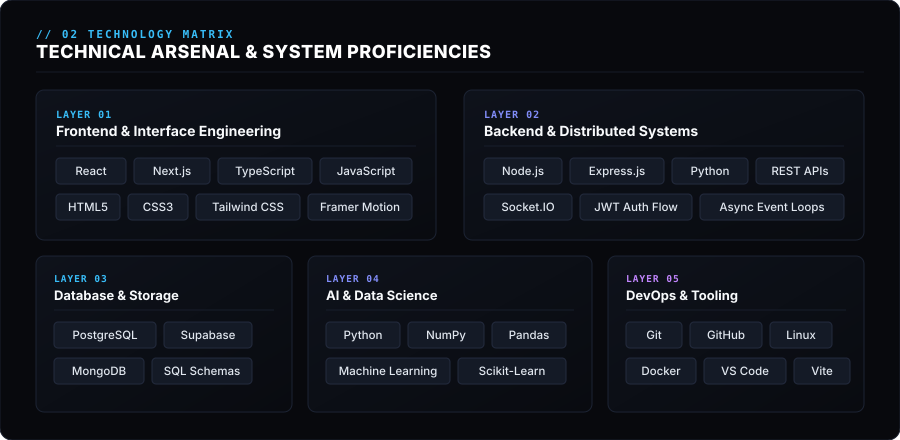
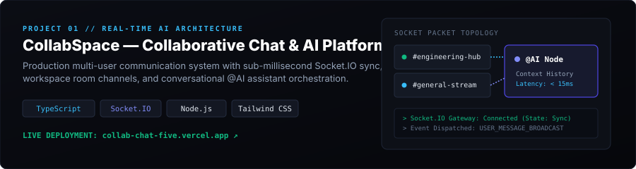
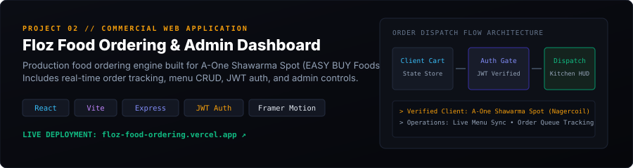
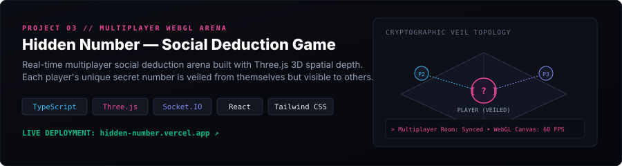
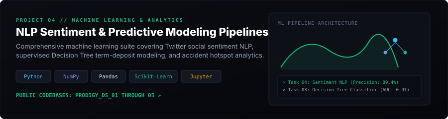
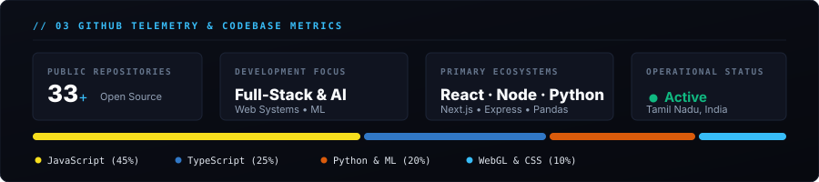
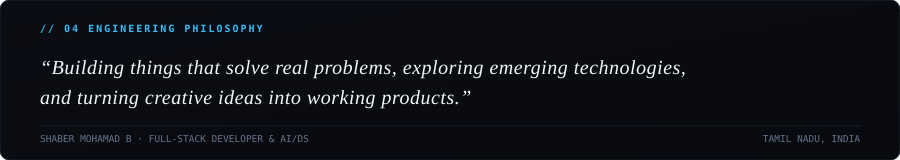
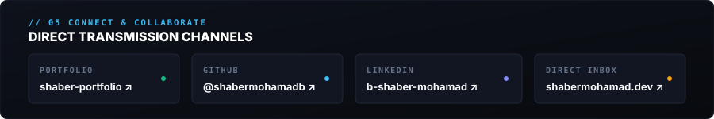

<div align="center">

<!-- HERO BANNER -->
<a href="https://shaber-portfolio-26bm-beta.vercel.app/">
  <picture>
    <source media="(prefers-color-scheme: dark)" srcset="assets/hero.svg">
    
  </picture>
</a>

<br/>

<!-- EDITORIAL FAST ACCESS -->
<p align="center">
  <a href="https://shaber-portfolio-26bm-beta.vercel.app/"><b>Live Portfolio ↗</b></a> &nbsp;&bull;&nbsp;
  <a href="https://github.com/shabermohamadb?tab=repositories"><b>Open Source Index ↗</b></a> &nbsp;&bull;&nbsp;
  <a href="https://www.linkedin.com/in/b-shaber-mohamad-73a612318"><b>LinkedIn Profile ↗</b></a> &nbsp;&bull;&nbsp;
  <a href="mailto:shabermohamad.dev@gmail.com"><b>Direct Transmission ↗</b></a>
</p>


</div>

## // 01 &nbsp; PROFILE &amp; DISCIPLINE

```
OPERATOR      : SHABER MOHAMAD B
SPECIALIZATION: Full-Stack Systems & Applied AI / Data Science
ACADEMIC ROOT : B.E. Artificial Intelligence & Data Science · Stella Mary's College of Engineering
COORDINATES   : 13.0827° N, 80.2707° E · Tamil Nadu, India
INDEX STATUS  : Active · Building Production Systems & Experimental Interfaces
```

I am an engineering student and developer focused on the intersection of **scalable full-stack web architectures**, **intelligent data systems**, and **creative interactive computing**. 

Rather than treating code as disconnected utilities, I approach software engineering as end-to-end craft: from structuring normalized database schemas and low-latency WebSocket backends to engineering high-framerate WebGL viewports and deploying real-world machine learning models.

* **Full-Stack Web Engineering:** Developing production single-page applications, distributed server architectures, real-time socket clusters, and JWT-authenticated API endpoints.
* **Artificial Intelligence & Data Science:** Designing supervised predictive models, natural language processing pipelines, sentiment classifiers, and exploratory data analytics.
* **Creative Software Engineering & 3D:** Building interactive browser-native 3D spatial environments (Three.js / React Three Fiber) with procedural lighting and smooth GSAP choreography.
* **Real-World Systems Focus:** Architecting practical products for verified commercial clients and open-source communities.

<div align="center">
  
</div>

## // 02 &nbsp; ENGINEERING STACK &amp; CAPABILITIES

<div align="center">
  
</div>

<br/>

| Layer | Primary Technologies | Architecture & Implementation Focus |
| :--- | :--- | :--- |
| **Frontend Architecture** | `React` `Next.js` `TypeScript` `JavaScript` `HTML5` `CSS3` `Tailwind CSS` `Framer Motion` | Modern component hierarchies, design systems, typed props, fluid micro-interactions, responsive mobile-first layouts |
| **Backend & Systems** | `Node.js` `Express.js` `Python` `REST APIs` `Socket.IO` `JWT Auth` | RESTful route architectures, asynchronous event loops, real-time bi-directional messaging, secured middleware pipelines |
| **Persistence & Data** | `PostgreSQL` `Supabase` `MongoDB` `SQL Schemas` | Relational schema design, ACID transactions, real-time database subscriptions, document collections |
| **AI & Data Science** | `Python` `NumPy` `Pandas` `Scikit-Learn` `Machine Learning` `Jupyter` | Data cleaning & feature engineering, Decision Tree classification, NLP sentiment scoring, exploratory statistical analysis |
| **DevOps & Tooling** | `Git` `GitHub` `Linux (Arch/Debian)` `Docker` `VS Code` `Vite` | Version control workflows, POSIX shell environments, containerization fundamentals, high-speed frontend bundlers |

<div align="center">
  
</div>

## // 03 &nbsp; SELECTED PROJECTS &amp; CODEBASES

An editorial selection of public repositories and deployed production platforms, verified directly from my GitHub profile.

---

### 01 &bull; CollabSpace &mdash; Real-Time Collaborative Workspace &amp; AI Node

<div align="center">
  <a href="https://collab-chat-five.vercel.app/">
    
  </a>
</div>

* **Architecture**: A production-grade multi-user collaboration platform designed for sub-millisecond team communication, room-based channel organization, and seamless `@AI` assistant participation in shared discussion threads.
* **Core Engineering**:
  * Real-time message streaming and client synchronization built with **Socket.IO** and **Node.js**.
  * Context-aware `@AI` conversational agent tracking workspace message history to generate contextual technical assistance.
  * Robust client interface with dark theme aesthetics, typing indicators, and room partition controls.
* **Technologies**: `TypeScript` &bull; `Node.js` &bull; `Express.js` &bull; `Socket.IO` &bull; `Tailwind CSS` &bull; `REST APIs`
* **Live Deployment**: [collab-chat-five.vercel.app ↗](https://collab-chat-five.vercel.app/)
* **Source Repository**: [github.com/shabermohamadb/collab-chat ↗](https://github.com/shabermohamadb/collab-chat)

---

### 02 &bull; Floz Food Commerce &mdash; Commercial Dispatch &amp; Administrative Suite

<div align="center">
  <a href="https://floz-food-ordering.vercel.app/">
    
  </a>
</div>

* **Architecture**: Complete commercial food ordering system and administrative dashboard built by **FLOZ Tech** for **A-One Shawarma Spot (EASY BUY Groceries & Foods)** in Nagercoil, Tamil Nadu.
* **Core Engineering**:
  * Persistent cart state engine with dynamic item options, real-time bill calculations, and discount structures.
  * Secured administrative portal featuring JWT authentication, menu CRUD orchestration, and live order status dispatching.
  * High-framerate transitions and fluid layout state changes powered by **Framer Motion**.
* **Technologies**: `React` &bull; `Vite` &bull; `Node.js` &bull; `Express.js` &bull; `JWT` &bull; `Framer Motion` &bull; `Tailwind CSS`
* **Live Deployment**: [floz-food-ordering.vercel.app ↗](https://floz-food-ordering.vercel.app/)
* **Source Repository**: [github.com/shabermohamadb/floz-food-ordering ↗](https://github.com/shabermohamadb/floz-food-ordering)

---

### 03 &bull; Hidden Number &mdash; Spatial Multiplayer Social Deduction Arena

<div align="center">
  <a href="https://hidden-number.vercel.app/">
    
  </a>
</div>

* **Architecture**: An AAA-inspired multiplayer social deduction party game built around spatial depth and information asymmetry: each participant in the arena is assigned a secret number visible to all opponents, but veiled from themselves.
* **Core Engineering**:
  * Synchronized WebSocket multiplayer lobby and turn cycle management via **Socket.IO**.
  * 3D spatial arena backdrop rendered with **Three.js** WebGL geometry, dynamic lighting, and camera parallax.
  * Cryptographic number masking state verified strictly server-side to prevent client-side inspection cheats.
* **Technologies**: `TypeScript` &bull; `React` &bull; `Three.js` &bull; `Socket.IO` &bull; `Tailwind CSS` &bull; `Vite`
* **Live Deployment**: [hidden-number.vercel.app ↗](https://hidden-number.vercel.app/)
* **Source Repository**: [github.com/shabermohamadb/hidden-number ↗](https://github.com/shabermohamadb/hidden-number)

---

### 04 &bull; Machine Learning Intelligence Suite &mdash; Predictive Modeling &amp; NLP

<div align="center">
  <a href="https://github.com/shabermohamadb/PRODIGY_DS_04">
    
  </a>
</div>

* **Architecture**: A rigorous series of machine learning and data science pipelines addressing real-world classification, sentiment analysis, and pattern discovery across diverse datasets.
* **Core Engineering**:
  * **Social Media Sentiment Classifier (`PRODIGY_DS_04`)**: Natural Language Processing pipeline analyzing brand sentiment, post classification, and public opinion trends across major tech entities.
  * **Supervised Decision Tree Modeling (`PRODIGY_DS_03`)**: Customer propensity classification on the UCI Bank dataset predicting term deposit subscriptions with hyperparameter pruning and ROC-AUC evaluation.
  * **Accident Hotspot Spatial Analytics (`PRODIGY_DS_05`)**: Country-wide US accident pattern analysis correlating weather severity, time-of-day distribution, and road condition risks.
  * **Titanic Demographic Survival Modeling (`PRODIGY_DS_02`)**: Exploratory data inspection, missing feature imputation, and multivariate survival pattern decoding.
* **Technologies**: `Python` &bull; `NumPy` &bull; `Pandas` &bull; `Scikit-Learn` &bull; `Matplotlib` &bull; `Seaborn` &bull; `Jupyter`
* **Source Repositories**: 
  [PRODIGY_DS_04 (Sentiment NLP) ↗](https://github.com/shabermohamadb/PRODIGY_DS_04) &bull; 
  [PRODIGY_DS_03 (Decision Trees) ↗](https://github.com/shabermohamadb/PRODIGY_DS_03) &bull; 
  [PRODIGY_DS_05 (Spatial Analytics) ↗](https://github.com/shabermohamadb/PRODIGY_DS_05)

---

### 05 &bull; DrawRealm &mdash; Distributed Cloud Canvas &amp; Collaborative Whiteboard

* **Architecture**: Multi-client interactive digital whiteboard enabling real-time simultaneous vector drawing, layer synchronization, and cloud state persistence.
* **Core Engineering**:
  * Real-time vector stroke broadcasting over WebSockets with client interpolation for jitter-free rendering.
  * Canvas snapshot state and room persistence powered by **Supabase** and **PostgreSQL**.
  * Optimized HTML5 Canvas rendering loop handling high-frequency stroke inputs without UI blocking.
* **Technologies**: `Supabase` &bull; `PostgreSQL` &bull; `Socket.IO` &bull; `Node.js` &bull; `Express.js` &bull; `HTML5 Canvas API`
* **Source Repository**: [github.com/shabermohamadb/DrawRealm ↗](https://github.com/shabermohamadb/DrawRealm)

<div align="center">
  
</div>

## // 04 &nbsp; GITHUB TELEMETRY &amp; ACTIVITY

<div align="center">

<!-- NATIVE PERSISTENT TELEMETRY CARD (Zero 503 errors, aligned to dark palette) -->


<br/><br/>

<!-- VERIFIED LIVE STREAK STATS -->
<a href="https://github.com/shabermohamadb">
  
</a>

</div>

<div align="center">
  
</div>

## // 05 &nbsp; CORE PHILOSOPHY

<div align="center">
  
</div>

<div align="center">
  
</div>

## // 06 &nbsp; TRANSMISSION &amp; CONTACT CHANNELS

Whether you want to discuss a full-stack engineering role, an AI/data science project, an open-source collaboration, or simply connect:

<div align="center">
  <a href="https://shaber-portfolio-26bm-beta.vercel.app/">
    
  </a>
</div>

<br/>

<div align="center">

| Channel | Coordinates | Response Latency |
| :--- | :--- | :--- |
| **Interactive Portfolio** | [shaber-portfolio-26bm-beta.vercel.app ↗](https://shaber-portfolio-26bm-beta.vercel.app/) | Active Deployment |
| **Professional Network** | [linkedin.com/in/b-shaber-mohamad-73a612318 ↗](https://www.linkedin.com/in/b-shaber-mohamad-73a612318) | &lt; 24 Hours |
| **Direct Electronic Mail** | [shabermohamad.dev@gmail.com](mailto:shabermohamad.dev@gmail.com) | Direct Inbox |
| **GitHub Profile** | [github.com/shabermohamadb ↗](https://github.com/shabermohamadb) | Primary Code Archive |

<br/>

<p align="center">
  <sub>SHABER MOHAMAD B &bull; ARCHITECTED WITH CARE &bull; 13.0827° N, 80.2707° E &bull; 2026</sub>
</p>

</div>
