

<!-- ========================================================================= -->
<!-- SECTION 01: CINEMATIC HERO                                                -->
<!-- ========================================================================= -->
<a href="https://shaber-portfolio-26bm-beta.vercel.app/">
  
</a>

 

<!-- TRANSMISSION ACTION HUD -->

  
  &nbsp;
  
  &nbsp;
  
  &nbsp;
  

 

<!-- ========================================================================= -->
<!-- SECTION 02: ABOUT / DEVELOPER PROFILE                                     -->
<!-- ========================================================================= -->

  

 

### `// 02. EXECUTIVE PROFILE`

> *"Software architecture is not merely about writing code; it is about orchestrating distributed concurrency, designing seamless spatial interfaces, and engineering systems that endure."*

I am **SHABER MOHAMAD B**, a Full-Stack Engineer and Artificial Intelligence & Data Science scholar at **Stella Mary's College of Engineering**, Tamil Nadu, India. 

My engineering discipline converges across three interconnected domains:
1. **High-Concurrency Real-Time Systems** &mdash; Designing low-latency, bidirectional WebSocket architectures with sub-millisecond state synchronization and automated thread daemons.
2. **Spatial Computing & 3D Interactive Graphics** &mdash; Constructing WebGL and Three.js environments that translate spatial mathematics into engaging digital experiences.
3. **Intelligent Application Software** &mdash; Engineering algorithmic system tools (including desktop EDA PCB routing suites with PySide6 and NumPy) and commercial full-stack business ecosystems.

 

  

 

<!-- ========================================================================= -->
<!-- SECTION 03: TECH CONSTELLATION                                            -->
<!-- ========================================================================= -->

  

 

### `// 03. VERIFIED CORE STACK`

| Cluster | Core Technologies | Focus &amp; Competency |
| :--- | :--- | :--- |
| **01. Frontend &amp; 3D** | `React` &bull; `Next.js` &bull; `TypeScript` &bull; `JavaScript` &bull; `Three.js (WebGL)` &bull; `Tailwind CSS` | Component architecture, WebGL shaders, responsive responsive layouts, spatial interaction |
| **02. Backend &amp; Real-Time** | `Node.js` &bull; `Express` &bull; `Socket.IO` &bull; `WebSockets` &bull; `Python` &bull; `REST APIs` &bull; `JWT Auth` | Bi-directional duplex conduits, room clustering, event-driven pipelines, secure authentication |
| **03. Database &amp; Cloud** | `PostgreSQL` &bull; `Supabase` &bull; `MongoDB` &bull; `SQLite` &bull; `Vercel Cloud` | Relational modeling, real-time change data capture, schema normalization, edge serverless |
| **04. AI, Systems &amp; Tools** | `Python` &bull; `PySide6 (Qt6)` &bull; `NumPy` &bull; `Git` &bull; `GitHub Actions` &bull; `Linux` &bull; `Docker` | Desktop EDA tooling, algorithmic routing, CI/CD automation, Unix environments |

 

 

  

 

<!-- ========================================================================= -->
<!-- SECTION 04: PROJECT UNIVERSE                                              -->
<!-- ========================================================================= -->

### `// 04. PROJECT UNIVERSE`

Every project featured here reflects production-grade engineering, public repositories, and live deployed systems.

 

<!-- FLAGSHIP PROJECT: COLLABSPACE -->

  <a href="https://github.com/shabermohamadb/collab-chat">
    
  </a>

<table width="100%">
  <tr>
    <td>
      <b>Project:</b> <a href="https://github.com/shabermohamadb/collab-chat"><b>CollabSpace</b></a> &bull; <i>Real-Time Collaborative Workspace &amp; AI Node Engine</i> 
      <b>Stack:</b> <code>TypeScript</code> &bull; <code>Node.js</code> &bull; <code>Express</code> &bull; <code>Socket.IO</code> &bull; <code>Tailwind CSS</code> 
      <b>Architecture:</b> Engineered multi-user room state synchronization with sub-millisecond duplex conduits, active presence telemetry, and contextual <code>@AI</code> assistant thread participation. 
      <b>Transmissions:</b> <a href="https://github.com/shabermohamadb/collab-chat"><b>Open Source Architecture &amp; Full Documentation ↗</b></a>
    </td>
  </tr>
</table>

 

<!-- PROJECT 02: FLOZ FOOD COMMERCE -->

  <a href="https://floz-food-ordering.vercel.app/">
    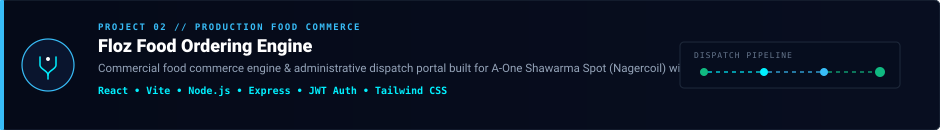
  </a>

<table width="100%">
  <tr>
    <td>
      <b>Project:</b> <a href="https://floz-food-ordering.vercel.app/"><b>Floz Food Commerce Engine</b></a> &bull; <i>Commercial Ordering &amp; Dispatch Platform</i> 
      <b>Stack:</b> <code>React</code> &bull; <code>Vite</code> &bull; <code>Node.js</code> &bull; <code>Express</code> &bull; <code>JWT Authentication</code> &bull; <code>Tailwind CSS</code> 
      <b>Architecture:</b> Production-ready digital ordering portal built for <i>A-One Shawarma Spot (Nagercoil)</i> featuring instant menu filtering, cart persistence, token-authenticated checkout, and real-time kitchen dispatch tracking. 
      <b>Transmissions:</b> <a href="https://floz-food-ordering.vercel.app/"><b>Live Commercial Demo ↗</b></a> &nbsp;&bull;&nbsp; <a href="https://github.com/shabermohamadb/floz-food-ordering"><b>Source Repository ↗</b></a>
    </td>
  </tr>
</table>

 

<!-- PROJECT 03: HIDDEN NUMBER 3D -->

  <a href="https://hidden-number.vercel.app/">
    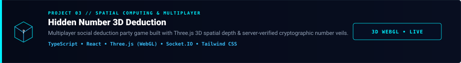
  </a>

<table width="100%">
  <tr>
    <td>
      <b>Project:</b> <a href="https://hidden-number.vercel.app/"><b>Hidden Number 3D Deduction</b></a> &bull; <i>Multiplayer Spatial Party Game</i> 
      <b>Stack:</b> <code>TypeScript</code> &bull; <code>React</code> &bull; <code>Three.js (WebGL)</code> &bull; <code>Socket.IO</code> &bull; <code>Tailwind CSS</code> 
      <b>Architecture:</b> Multiplayer social deduction platform featuring real-time 3D camera transforms, spatial WebGL visual depth, and server-verified cryptographic number veils preventing client-side inspection. 
      <b>Transmissions:</b> <a href="https://hidden-number.vercel.app/"><b>Live 3D Web Application ↗</b></a> &nbsp;&bull;&nbsp; <a href="https://github.com/shabermohamadb/hidden-number"><b>Source Repository ↗</b></a>
    </td>
  </tr>
</table>

 

<!-- PROJECT 04: AL-AMEEN AUTOMATION -->

  <a href="https://al-ameen-automation.vercel.app/">
    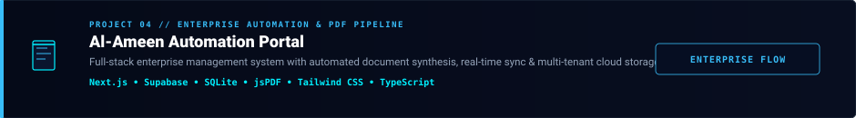
  </a>

<table width="100%">
  <tr>
    <td>
      <b>Project:</b> <a href="https://al-ameen-automation.vercel.app/"><b>Al-Ameen Enterprise Flow</b></a> &bull; <i>Enterprise Workflow &amp; Automated Document Synthesis</i> 
      <b>Stack:</b> <code>Next.js</code> &bull; <code>TypeScript</code> &bull; <code>Supabase</code> &bull; <code>SQLite</code> &bull; <code>jsPDF</code> &bull; <code>Tailwind CSS</code> 
      <b>Architecture:</b> Corporate automation system engineered for transactional recordkeeping, instantaneous PDF invoice generation, multi-tenant database synchronization, and audit logging. 
      <b>Transmissions:</b> <a href="https://al-ameen-automation.vercel.app/"><b>Live Automation Portal ↗</b></a> &nbsp;&bull;&nbsp; <a href="https://github.com/shabermohamadb/al-ameen-automation"><b>Source Repository ↗</b></a>
    </td>
  </tr>
</table>

 

<!-- PROJECT 05: CIRCUITX EDA -->

  <a href="https://github.com/shabermohamadb/AI-Based-PCP-Design-Software">
    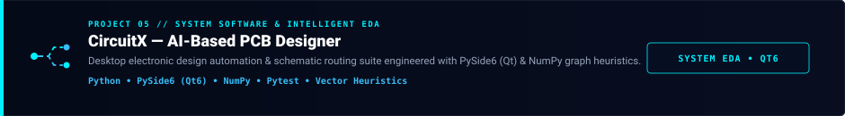
  </a>

<table width="100%">
  <tr>
    <td>
      <b>Project:</b> <a href="https://github.com/shabermohamadb/AI-Based-PCP-Design-Software"><b>CircuitX &mdash; AI PCB Designer</b></a> &bull; <i>Desktop Electronic Design Automation (EDA)</i> 
      <b>Stack:</b> <code>Python</code> &bull; <code>PySide6 (Qt6)</code> &bull; <code>NumPy</code> &bull; <code>Pytest</code> &bull; <code>Graph Routing</code> 
      <b>Architecture:</b> System software providing vector schematic capture, netlist verification, dynamic pin mapping, and algorithmic trace optimization using NumPy graph heuristics. 
      <b>Transmissions:</b> <a href="https://github.com/shabermohamadb/AI-Based-PCP-Design-Software"><b>Source Code &amp; EDA Engine ↗</b></a>
    </td>
  </tr>
</table>

 

<!-- PROJECT 06: OGGY 3D WORLD -->

  <a href="https://oggy-house-3d-model.vercel.app/">
    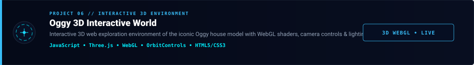
  </a>

<table width="100%">
  <tr>
    <td>
      <b>Project:</b> <a href="https://oggy-house-3d-model.vercel.app/"><b>Oggy 3D Interactive World</b></a> &bull; <i>WebGL Spatial Architectural Exploration</i> 
      <b>Stack:</b> <code>JavaScript</code> &bull; <code>Three.js</code> &bull; <code>WebGL</code> &bull; <code>OrbitControls</code> &bull; <code>HTML5/CSS3</code> 
      <b>Architecture:</b> Interactive 3D scene reconstruction featuring directional lighting, custom camera viewports, perspective meshes, and smooth WebGL rendering. 
      <b>Transmissions:</b> <a href="https://oggy-house-3d-model.vercel.app/"><b>Live 3D Scene ↗</b></a> &nbsp;&bull;&nbsp; <a href="https://github.com/shabermohamadb/oggy-house-3d-model"><b>Source Repository ↗</b></a>
    </td>
  </tr>
</table>

 

  

 

<!-- ========================================================================= -->
<!-- SECTION 05: GITHUB ANALYTICS & TELEMETRY                                 -->
<!-- ========================================================================= -->

  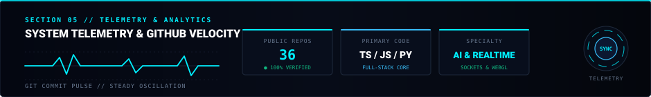

    

  <!-- GitHub Contribution Grid Snake (Electric Cyan Edition) -->
  <picture>
    <source media="(prefers-color-scheme: dark)" srcset="https://raw.githubusercontent.com/shabermohamadb/shabermohamadb/output/github-contribution-grid-snake-dark.svg" />
    
  </picture>

    

  <!-- Verified Streak Telemetry Card -->
  

    

  <!-- Activity Graph -->
  

 

  

 

<!-- ========================================================================= -->
<!-- SECTION 06: CODE IN MOTION                                                -->
<!-- ========================================================================= -->

  

 

### `// 06. ARCHITECTURE IN MOTION`

This bespoke motion graphic illustrates how data traverses my full-stack applications in production:
* **Stage 01 (Client Layer)**: Browser DOM and Three.js WebGL canvas captures user input and triggers state transitions.
* **Stage 02 (Edge Gateway)**: Secure reverse proxy authenticates JWT tokens, applies rate limiting, and routes requests.
* **Stage 03 (Socket.IO Hub)**: Central bi-directional WebSocket broker synchronizes state across multi-tenant rooms.
* **Stage 04 (Worker Runtime)**: Node.js worker threads and Python scripts compute business logic and spatial heuristics.
* **Stage 05 (Persistence & AI Memory)**: Structured data commits to PostgreSQL / Supabase, while vector representations synchronize with AI daemons.

 

  

 

<!-- ========================================================================= -->
<!-- SECTION 07: CURRENTLY BUILDING / ACTIVE TERMINAL                         -->
<!-- ========================================================================= -->

  

 

### `// 07. ACTIVE ENGINEERING ROADMAP`

* `[INITIATIVE-01]` Expanding the **Floz Commerce Ecosystem** with multi-vendor dispatching and kitchen telemetry displays.
* `[INITIATIVE-02]` Researching graph-based auto-routing algorithms for **CircuitX AI PCB Designer** in Python/NumPy.
* `[INITIATIVE-03]` Advancing WebGL spatial multi-user room interaction in Three.js and Socket.IO.
* `[INITIATIVE-04]` Deepening neural optimization and predictive models within B.Tech AI & Data Science coursework at Stella Mary's College of Engineering.

 

  

 

<!-- ========================================================================= -->
<!-- SECTION 08: CONNECT & FOOTER                                              -->
<!-- ========================================================================= -->

  <a href="https://shaber-portfolio-26bm-beta.vercel.app/">
    
  </a>

    

  

    
    &nbsp;
    
    &nbsp;
    
    &nbsp;
    
  

  SHABER MOHAMAD B &bull; B.TECH AI &amp; DS &bull; STELLA MARY&apos;S COLLEGE OF ENGINEERING &bull; TAMIL NADU, INDIA

