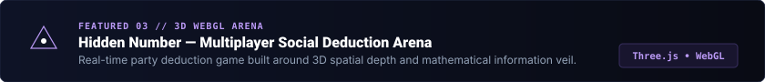

<!-- 1. HERO BANNER -->

 

  <a href="https://shaber-portfolio-26bm-beta.vercel.app/"><b>Portfolio</b></a> &nbsp;&bull;&nbsp;
  <a href="https://www.linkedin.com/in/b-shaber-mohamad-73a612318"><b>LinkedIn</b></a> &nbsp;&bull;&nbsp;
  <a href="https://github.com/shabermohamadb"><b>GitHub</b></a> &nbsp;&bull;&nbsp;
  <a href="mailto:shabermohamad.dev@gmail.com"><b>Email</b></a>

### About Me

I am a Full-Stack Developer and AI & Data Science student based in Tamil Nadu, India. Passionate about building distributed real-time web applications, interactive 3D digital experiences, and practical machine learning systems.

  

### Tech Stack

| Discipline | Core Technologies |
| :--- | :--- |
| **Frontend** |  |
| **Backend** |  |
| **Database & Cloud** |  |
| **AI & Tools** |  |

  

### Featured Projects

<!-- Project 1: CollabSpace -->

  <b>CollabSpace</b> &mdash; Real-time team collaboration platform with sub-millisecond Socket.IO sync and contextual <code>@AI</code> assistant thread participation. 
  <b>Tech:</b> <code>TypeScript</code> &bull; <code>Node.js</code> &bull; <code>Express</code> &bull; <code>Socket.IO</code> &bull; <code>Tailwind CSS</code> 
  <b>Links:</b> <a href="https://collab-chat-five.vercel.app/">Live Demo ↗</a> &bull; <a href="https://github.com/shabermohamadb/collab-chat">Source Code ↗</a>

 

<!-- Project 2: Floz Food Ordering -->

  <b>Floz Food Commerce</b> &mdash; Commercial food ordering engine and administrative dashboard built for <i>A-One Shawarma Spot (Nagercoil)</i> with live dispatching. 
  <b>Tech:</b> <code>React</code> &bull; <code>Vite</code> &bull; <code>Node.js</code> &bull; <code>Express</code> &bull; <code>JWT</code> &bull; <code>Framer Motion</code> 
  <b>Links:</b> <a href="https://floz-food-ordering.vercel.app/">Live Demo ↗</a> &bull; <a href="https://github.com/shabermohamadb/floz-food-ordering">Source Code ↗</a>

 

<!-- Project 3: Hidden Number -->

  <b>Hidden Number</b> &mdash; Multiplayer social deduction party game built with Three.js 3D spatial depth and server-verified cryptographic number veils. 
  <b>Tech:</b> <code>TypeScript</code> &bull; <code>React</code> &bull; <code>Three.js (WebGL)</code> &bull; <code>Socket.IO</code> &bull; <code>Tailwind CSS</code> 
  <b>Links:</b> <a href="https://hidden-number.vercel.app/">Live Demo ↗</a> &bull; <a href="https://github.com/shabermohamadb/hidden-number">Source Code ↗</a>

  

### GitHub Activity

<!-- Contribution Snake Animation -->
<picture>
  <source media="(prefers-color-scheme: dark)" srcset="https://raw.githubusercontent.com/shabermohamadb/shabermohamadb/output/github-contribution-grid-snake-dark.svg">
  
</picture>

 

<!-- Contribution Streak Stats -->

 

<!-- FOOTER SCENE -->

  

  

    <a href="https://shaber-portfolio-26bm-beta.vercel.app/">Portfolio</a> &bull;
    <a href="https://www.linkedin.com/in/b-shaber-mohamad-73a612318">LinkedIn</a> &bull;
    <a href="mailto:shabermohamad.dev@gmail.com">Email</a> &bull;
    <a href="https://github.com/shabermohamadb">GitHub</a>
  

  SHABER MOHAMAD B &bull; TAMIL NADU, INDIA

