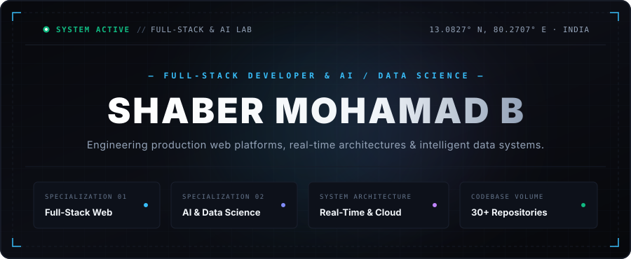

 

  <a href="https://shaber-portfolio-26bm-beta.vercel.app/">Portfolio</a> &nbsp;&bull;&nbsp;
  <a href="https://www.linkedin.com/in/b-shaber-mohamad-73a612318">LinkedIn</a> &nbsp;&bull;&nbsp;
  <a href="https://github.com/shabermohamadb">GitHub</a> &nbsp;&bull;&nbsp;
  <a href="mailto:shabermohamad.dev@gmail.com">Email</a>

---

### About Me

I'm a full-stack developer and AI & Data Science student based in Tamil Nadu, India. I build real-time web applications, interactive 3D experiences, and practical machine learning pipelines. Passionate about clean software architecture, intuitive design, and turning complex ideas into functional products.

---

### Tech Stack

  

* **Frontend:** React, Next.js, TypeScript, JavaScript, HTML5/CSS3, Tailwind CSS, Framer Motion, Three.js
* **Backend:** Node.js, Express.js, Python, REST APIs, Socket.IO, JWT
* **Databases:** PostgreSQL, Supabase, MongoDB
* **AI & Data Science:** Python, NumPy, Pandas, Scikit-Learn, Jupyter
* **Tools & Systems:** Git, GitHub, Linux, Docker, Vite, VS Code

---

### Selected Projects

#### [CollabSpace](https://collab-chat-five.vercel.app/)
A production-grade, real-time collaborative workspace featuring instant messaging across dedicated team rooms and contextual `@AI` assistant threads.
* **Stack:** TypeScript, Node.js, Express, Socket.IO, Tailwind CSS
* **Links:** [Live Demo](https://collab-chat-five.vercel.app/) &bull; [Source Code](https://github.com/shabermohamadb/collab-chat)

#### [Floz Food Ordering](https://floz-food-ordering.vercel.app/)
Commercial food ordering application and administrative dashboard engineered for *A-One Shawarma Spot (EASY BUY Groceries & Foods)*. Features dynamic cart state, JWT authentication, and live kitchen dispatch.
* **Stack:** React, Vite, Node.js, Express, JWT, Framer Motion
* **Links:** [Live Demo](https://floz-food-ordering.vercel.app/) &bull; [Source Code](https://github.com/shabermohamadb/floz-food-ordering)

#### [Hidden Number](https://hidden-number.vercel.app/)
Multiplayer social deduction party game built around spatial depth and information asymmetry: each player's unique secret number is visible to everyone except themselves.
* **Stack:** TypeScript, React, Three.js, Socket.IO, Tailwind CSS
* **Links:** [Live Demo](https://hidden-number.vercel.app/) &bull; [Source Code](https://github.com/shabermohamadb/hidden-number)

#### [Machine Learning Intelligence Suite](https://github.com/shabermohamadb/PRODIGY_DS_04)
Applied machine learning and data science pipelines covering Twitter brand sentiment NLP (`PRODIGY_DS_04`), customer term-deposit Decision Tree classification (`PRODIGY_DS_03`), and US traffic accident spatial analytics (`PRODIGY_DS_05`).
* **Stack:** Python, NumPy, Pandas, Scikit-Learn, Matplotlib, Seaborn
* **Links:** [Source Code](https://github.com/shabermohamadb/PRODIGY_DS_04)

---

### GitHub Activity

  

---

### Developer Philosophy

> *"Building things that solve real problems, exploring emerging technologies, and turning creative ideas into working products."*

---

### Connect

Feel free to reach out for engineering roles, project collaborations, or technical discussions:

* **Portfolio:** [shaber-portfolio-26bm-beta.vercel.app](https://shaber-portfolio-26bm-beta.vercel.app/)
* **LinkedIn:** [linkedin.com/in/b-shaber-mohamad-73a612318](https://www.linkedin.com/in/b-shaber-mohamad-73a612318)
* **Email:** [shabermohamad.dev@gmail.com](mailto:shabermohamad.dev@gmail.com)
* **GitHub:** [github.com/shabermohamadb](https://github.com/shabermohamadb)
